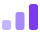
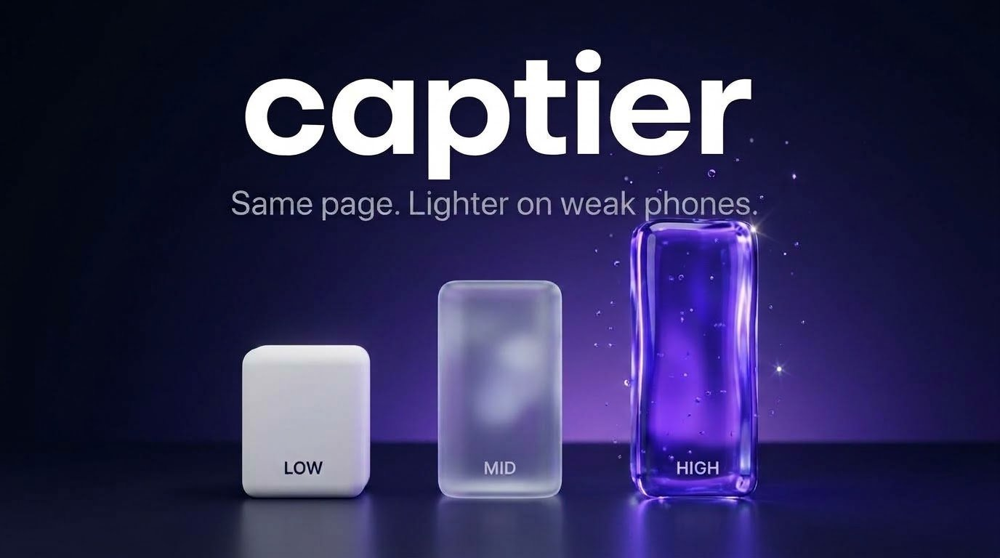

<p align="center"><a href="README.md">📖 English version</a></p>

<p align="center">
  
</p>

<h1 align="center">captier</h1>

<p align="center">تیِرهای کوچک قدرت دستگاه برای وب — low و mid و high، زیر ۲ کیلوبایت.</p>

<p align="center">
  <a href="https://mrtinmlr.github.io/captier/"><strong>دموی زنده را ببینید »</strong></a>
</p>

<p align="center">
  <a href="https://github.com/MrtinMlr/captier/releases"></a>
  <a href="https://mrtinmlr.github.io/captier/"></a>
  
  <a href="LICENSE"></a>
</p>

<p align="center">
  
</p>

یک قطعه کد کوچک که قبل از اولین رندر، روی تگ html مقدار data-tier را می‌گذارد: low یا mid یا high. با این کار CSS شما می‌تواند روی گوشی‌های ضعیف بلور، انیمیشن سنگین و سه‌بعدی را خاموش کند و جاوااسکریپت شما می‌تواند ایمپورت‌های سنگین را اصلاً لود نکند. بدون وابستگی، بدون شبکه، بدون مرحله‌ی بیلد.

## شروع سریع

چند راه برای شروع سریع وجود دارد:

- **CDN (راحت‌ترین راه):**
  ```html
  <script src="https://cdn.jsdelivr.net/gh/MrtinMlr/captier@main/captier.min.js"></script>
  <link rel="stylesheet" href="https://cdn.jsdelivr.net/gh/MrtinMlr/captier@main/captier.css">
  ```
  تگ script را در head و قبل از CSS بگذارید — تیِر باید قبل از اولین رندر ست شود.
- **دانلود آخرین نسخه:** [captier.zip](https://github.com/MrtinMlr/captier/archive/refs/heads/main.zip)
- **کلون ریپو:** `git clone https://github.com/MrtinMlr/captier.git`
- **نصب با npm:** `npm install captier` — اسم در npm آزاد است ولی پکیج هنوز منتشر نشده. تا آن موقع از لینک‌های CDN بالا استفاده کنید.

[دموی زنده / مستندات](https://mrtinmlr.github.io/captier/) را ببینید؛ دموی تعاملی، تست استرس و اسنیپت‌های آماده‌ی کپی آن‌جاست.

## وضعیت

**نسخه‌ی 0.1.0 — نمونه‌ی اولیه.** تشخیص تیِر ایستا تست شده (دستگاه ضعیف ۲ هسته و ۲ گیگابایت می‌شود low، دستگاه قوی ۸ هسته و ۸ گیگابایت می‌شود high، با `?cap=low` می‌شود اورراید کرد، و `prefers-reduced-motion` و `saveData` تیِر را low می‌کنند). مسیر افت FPS در مرورگر واقعی تأیید شده (کروم headless، نوامبر ۲۰۲۶: از mid به low زیر بار واقعیِ هر فریم، هم موقع لود و هم با `Captier.recheck()`). سیگنال‌های ایستا فقط در کرومیوم هستند — مرورگرهای دیگر به مقادیر پیش‌فرضِ میانه برمی‌گردند.

## چه چیزی داخل دانلود است

در دانلود این فایل‌ها را پیدا می‌کنید:

```
captier/
├── captier.js       # سورس خوانا (۲٫۶ کیلوبایت)
├── captier.min.js   # مینیفای‌شده (۱٫۸ کیلوبایت)
├── captier.css      # استایل همراه (۶۴۸ بایت)
├── index.html        # داک + دموی تعاملی (GitHub Pages)
├── logo.svg          # لوگو
├── banner.jpg        # بنر
├── README.md         # مستندات انگلیسی
├── README-fa.md      # مستندات فارسی
├── skills/
│   └── captier/
│       └── SKILL.md  # اسکیل برای ایجنت‌های هوش مصنوعی
├── vendor/           # ری‌اکت ۱۹٫۳٫۱ + glisse 0.6.0 (فقط برای صفحه‌ی دمو، فقط روی high لود می‌شود)
├── LICENSE           # MIT
```

## چطور کار می‌کند

۱. **تیِر اولیه (سیگنال‌های ایستا):** تعداد هسته‌ها و حافظه‌ی دستگاه، به‌علاوه‌ی حالت ذخیره‌ی داده و اتصال کند. اگر کاربر کاهش حرکت (prefers-reduced-motion) را فعال کرده باشد، تیِر low می‌شود.
۲. **چک زمان اجرا (FPS):** حدود ۲ ثانیه نمونه‌برداری بعد از لود صفحه. اگر میانگین FPS زیر ۳۰ باشد، تیِر یک پله پایین می‌آید. فقط پایین می‌رود، هیچ‌وقت بالا نمی‌رود — پس صفحه هیچ‌وقت به افکت‌های سنگین برنمی‌گردد و چشمک نمی‌زند. با `Captier.recheck()` همین چک را هر وقت بخواهید دوباره اجرا کنید.
۳. **اورراید دستی برنده است:** با `?cap=low` در آدرس، یا `localStorage`، یا `Captier.set("low")`. اورراید تیِر را قفل می‌کند و دیگر افت FPS اتفاق نمی‌افتد.

## تیِرها

| تیِر | بلور | انیمیشن سنگین | سه‌بعدی | ایمپورت سنگین |
| --- | --- | --- | --- | --- |
| low | رنگ ثابت | خاموش | خاموش | لود نمی‌شود |
| mid | می‌ماند | خاموش | می‌ماند | به انتخاب شما |
| high | می‌ماند | می‌ماند | می‌ماند | لود می‌شود |

اسکریپت هم data-tier و هم کلاس cap-low و cap-mid و cap-high را روی تگ html می‌گذارد. استایل همراه، کار مشخصی می‌کند:

```css
[data-tier="low"] .glass { backdrop-filter: none; background: var(--glass-fallback, rgba(20,20,24,.92)); }
[data-tier="mid"] .anim-heavy { animation: none; }
```

با تعریف `--glass-fallback` رنگ ثابتی را انتخاب کنید که دستگاه‌های تیِر low به‌جای بلور می‌گیرند.

## API

| فراخوانی | چه می‌کند |
| --- | --- |
| `Captier.tier()` | برمی‌گرداند low یا mid یا high |
| `Captier.set("low")` | یک تیِر را اجبار می‌کند و در localStorage ذخیره‌اش می‌کند |
| `Captier.recheck()` | چک حدوداً ۲ ثانیه‌ای FPS را دوباره اجرا می‌کند (فقط به سمت پایین) |
| `?cap=low` | اورراید با URL — برای تست عالی است |

```js
// کار سنگین را روی دستگاه ضعیف اصلاً لود نکن
if (Captier.tier() !== "low") {
  import("./heavy-3d.js");
}
```

## چرا captier

گوشی‌های ضعیف همان صفحه‌ی سنگین را می‌گیرند که گوشی‌های قوی می‌گیرند. صدها میلیون نفر با گوشی‌های ۲ گیگابایت یا کمتر وب‌گردی می‌کنند و بیشتر سایت‌ها برای همه یک نسخه می‌فرستند.

captier حجم دانلود صفحه را عوض نمی‌کند؛ کار رندر روی دستگاه ضعیف را کم می‌کند: بلور، انیمیشن سنگین و سه‌بعدی را خاموش می‌کند و ایمپورت‌های سنگین را لود نمی‌کند.

اسمش هم خودِ ایده است: cap یعنی توان دستگاه، tier یعنی طبقه — سه طبقه: low و mid و high.

محدودیت صادقانه: این ابزار افکت‌ها را کنترل می‌کند، نه حجم دانلود را. یک صفحه‌ی ۲ مگابایتی را درست نمی‌کند؛ یک صفحه‌ی خوب‌ساخته‌شده را روی گوشی ضعیف ارزان‌تر رندر می‌کند.

## برای ایجنت‌های هوش مصنوعی

اگر با یک ایجنت هوش مصنوعی کار می‌کنید، اسکیل captier را نصب کنید تا بداند چطور از این ابزار استفاده کند:

```sh
npx skills add MrtinMlr/captier
```

اسکیل در `skills/captier/SKILL.md` است: کی از captier استفاده کند، نصب، سه قدم استفاده، API و اشتباه‌های رایج.

## مستندات

مستندات captier همان صفحه‌ی دموی داخل ریپوست که روی GitHub Pages میزبانی می‌شود: <https://mrtinmlr.github.io/captier/> — دموی تعاملی، تست استرس و اسنیپت‌های آماده‌ی نصب هم داخلش هست.

## باگ و درخواست قابلیت

باگ یا درخواست قابلیتی دارید؟ اول ایشوهای باز و بسته را جستجو کنید. اگر مشکل یا ایده‌تان آن‌جا نیست، [یک ایشوی جدید باز کنید](https://github.com/MrtinMlr/captier/issues/new).

## مشارکت

کوچک و متمرکز، بهتر از بزرگ و باهوش است — این کل نکته‌ی این کتابخانه است. اگر می‌خواهید مشارکت کنید: بدون وابستگی بماند، بیلد مینیفای‌شده زیر ۲ کیلوبایت بماند، قانون «فقط به سمت پایین» حفظ شود و برای هر تغییر رفتاری یک تست هم باشد. پول‌ریکوئست‌ها خوش‌آمدند.

## نسخه‌بندی

برای شفافیت در چرخه‌ی انتشار و حفظ سازگاری با نسخه‌های قبلی، captier تحت [راهنمای Semantic Versioning](https://semver.org/) نگهداری می‌شود. برای تغییرات هر نسخه به [بخش Releases](https://github.com/MrtinMlr/captier/releases) نگاه کنید.

## کپی‌رایت و لایسنس

کد و مستندات © ۲۰۲۶ مارتین میلر. کد تحت [لایسنس MIT](LICENSE) منتشر شده است.
