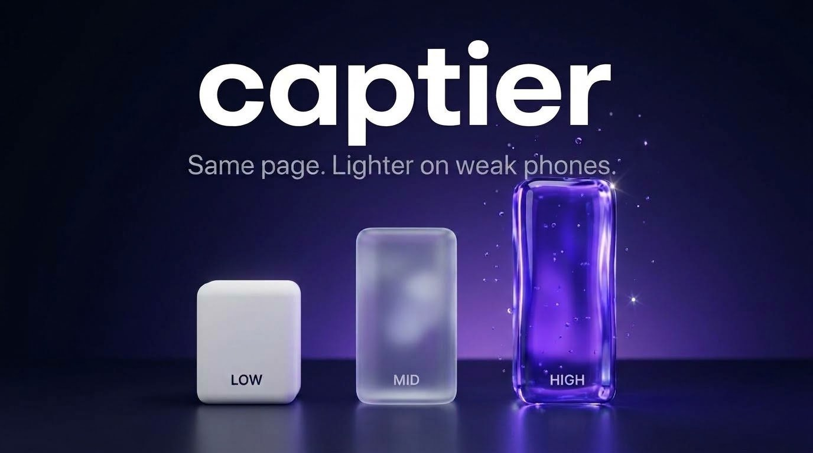

<p align="center"><a href="README-fa.md">📖 نسخه فارسی</a></p>

<p align="center">
  
</p>

<h1 align="center">captier</h1>

<p align="center">Tiny capability tiers for the web — <code>low</code> / <code>mid</code> / <code>high</code>, under 2 KB.</p>

<p align="center">
  <a href="https://mrtinmlr.github.io/captier/"><strong>Explore the live demo »</strong></a>
</p>

<p align="center">
  <a href="https://github.com/MrtinMlr/captier/releases"></a>
  <a href="https://mrtinmlr.github.io/captier/"></a>
  
  <a href="LICENSE"></a>
</p>

<p align="center">
  
</p>

A snippet that sets `data-tier="low|mid|high"` on `<html>` **before first paint**, so your CSS can turn off blur, heavy animation and 3D on weak devices — and your JS can skip heavy imports entirely. No dependencies, no network, no build step.

## Table of contents

- [Quick start](#quick-start)
- [Status](#status)
- [What's included](#whats-included)
- [How it works](#how-it-works)
- [Tiers](#tiers)
- [API](#api)
- [Why captier](#why-captier)
- [Documentation](#documentation)
- [For AI agents](#for-ai-agents)
- [Bugs and feature requests](#bugs-and-feature-requests)
- [Contributing](#contributing)
- [Versioning](#versioning)
- [Copyright and license](#copyright-and-license)

## Quick start

Several quick start options are available:

- **CDN (easiest):**
  ```html
  <script src="https://cdn.jsdelivr.net/gh/MrtinMlr/captier@main/captier.min.js"></script>
  <link rel="stylesheet" href="https://cdn.jsdelivr.net/gh/MrtinMlr/captier@main/captier.css">
  ```
  Put the `<script>` in `<head>` **before your CSS** — the tier must be set before first paint.
- **Download the latest release:** [captier.zip](https://github.com/MrtinMlr/captier/archive/refs/heads/main.zip)
- **Clone the repo:** `git clone https://github.com/MrtinMlr/captier.git`
- **Install with npm:** `npm install captier` — the name is free on npm but the package isn't published yet. Until then, use the CDN links above.

Read the [live demo / docs](https://mrtinmlr.github.io/captier/) for the interactive demo, the stress test, and copy-paste snippets.

## Status

**v0.1.0 — prototype.** Static tier detection is smoke-tested (weak 2-core/2 GB → `low`, strong 8-core/8 GB → `high`, `?cap=low` overrides, `prefers-reduced-motion` and `saveData` force `low`). The FPS downgrade path is **verified in a real browser** (headless Chrome, Nov 2026: `mid` → `low` under real per-frame load, both at load time and via `Captier.recheck()`). The static signals (`deviceMemory`, `hardwareConcurrency`, `effectiveType`) are Chromium-only — other browsers fall back to mid-range defaults.

## What's included

Within the download you'll find the following files:

```
captier/
├── captier.js       # readable source (2.6 KB)
├── captier.min.js   # minified (1.8 KB)
├── captier.css      # companion stylesheet (648 B)
├── index.html        # docs + interactive demo (GitHub Pages)
├── logo.svg          # logo
├── banner.jpg        # banner
├── README.md         # English docs
├── README-fa.md      # Persian docs (فارسی)
├── skills/
│   └── captier/
│       └── SKILL.md  # skill for AI agents
├── vendor/           # React 19.3.1 + glisse 0.6.0 (demo page only, lazy on high)
└── LICENSE           # MIT
```

## How it works

1. **Initial tier (static signals):** `hardwareConcurrency` + `deviceMemory` (+ `saveData` / slow `effectiveType`). `prefers-reduced-motion: reduce` forces `low`.
2. **Runtime check (FPS):** ~2 s of `requestAnimationFrame` sampling after `load`. If average FPS is under 30, the tier drops **one level**. It can only downgrade, never upgrade — so the page never flickers back to heavy effects. `Captier.recheck()` re-runs the check on demand.
3. **Manual override wins:** `?cap=low|mid|high`, `localStorage["captier"]`, or `window.Captier.set("low")`. An override locks the tier (no FPS downgrade).

## Tiers

| Tier | Blur | Heavy animation | 3D | Heavy JS imports |
| --- | --- | --- | --- | --- |
| `low` | solid tint | off | off | skip |
| `mid` | kept | off | kept | your call |
| `high` | kept | kept | kept | load |

The script sets both `data-tier` and a `cap-low` / `cap-mid` / `cap-high` class on `<html>`. The companion stylesheet does the obvious thing:

```css
[data-tier="low"] .glass { backdrop-filter: none; background: var(--glass-fallback, rgba(20,20,24,.92)); }
[data-tier="mid"] .anim-heavy { animation: none; }
```

Define `--glass-fallback` to choose the solid color low-tier devices get instead of blur.

## API

| Call | Does what |
| --- | --- |
| `Captier.tier()` | returns `"low" \| "mid" \| "high"` |
| `Captier.set("low")` | forces a tier, remembers it in `localStorage` |
| `Captier.recheck()` | re-runs the ~2 s FPS check on demand (downgrade-only) |
| `?cap=low` | URL override — handy for testing |

```js
// Skip heavy work entirely on weak devices
if (Captier.tier() !== "low") {
  import("./heavy-3d.js");
}
```

## Why captier

Weak phones get the same heavy page strong phones get. Hundreds of millions of people browse on ≤2 GB Android devices, yet most sites ship one version to everyone.

captier doesn't change how much a page downloads — it changes how much rendering work a page does on a weak device: it turns off blur, heavy animation and 3D, and skips heavy imports.

The name is the idea: **cap** = capability (how powerful the device is), **tier** = a level — three tiers, `low` / `mid` / `high`.

The honest limit: it gates effects, not payload. It will not fix a 2 MB page — it makes a well-built page cheaper to render on a weak phone.

## Documentation

captier's documentation is the demo page in this repo, hosted on GitHub Pages at <https://mrtinmlr.github.io/captier/> — interactive demo, stress test, and copy-paste install snippets included.

## For AI agents

If you work with an AI agent, install the captier skill so it knows how to use this tool:

```sh
npx skills add MrtinMlr/captier
```

The skill lives in [`skills/captier/SKILL.md`](skills/captier/SKILL.md): when to use captier, install, the three-step usage, the API, and the common mistakes.

## Bugs and feature requests

Have a bug or a feature request? Please first search for existing and closed issues. If your problem or idea is not addressed yet, [please open a new issue](https://github.com/MrtinMlr/captier/issues/new).

## Contributing

Small and focused beats big and clever — that's the whole point of this library. If you want to contribute: keep it dependency-free, keep the minified build under 2 KB, keep the downgrade-only rule, and include a test for any behavior change (see the smoke test notes in the repo). Pull requests are welcome.

## Versioning

For transparency into the release cycle and in striving to maintain backward compatibility, captier is maintained under [the Semantic Versioning guidelines](https://semver.org/). See [the Releases section](https://github.com/MrtinMlr/captier/releases) for changelogs.

## Copyright and license

Code and documentation copyright 2026 Martin Miller. Code released under the [MIT License](LICENSE).
